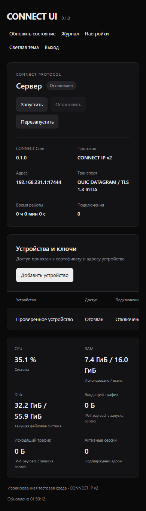

# CONNECT UI 0.1.0

Первая локальная панель управления экспериментальным CONNECT IP v2. Три отдельных
компонента в существующем репозитории:

- `connect-core`: совместимый существующий клиент и лабораторный движок.
- `connect-control`: защищённый локальный интерфейс, постоянное состояние устройств,
  управление настоящим QUIC/TUN сервером в собственном процессе.
- `connect-ui`: непривилегированный HTTP-сервер панели, авторизация и ограниченный
  серверный прокси к `connect-control`. Токен ядра никогда не попадает в браузер.

Панель не подключается к уже запущенному `ip-server`, не управляет systemd и не
останавливает посторонние процессы. Для управляемого сервера единственный источник
состояния — `control/state.json`. Старый `ip-server` остаётся совместимым режимом
с неизменяемой политикой: не запускайте его вместо управляющего процесса, иначе
он не прочитает новые отказы доступа. Не используйте старый исходный JSON для
восстановления управляемого сервера после отзыва.

## Установка и первый вход

Go 1.27.0, Windows или Linux. Никаких Node-зависимостей для самой панели нет;
HTML/CSS/JS встроены в бинарный файл. Node/Playwright нужны только браузерному тесту.

```text
go build -o bin/ ./cmd/connect-core ./cmd/connect-control ./cmd/connect-ui
bin/connect-core init-lab panel-lab
bin/connect-control init control panel-lab/ip-server.json
bin/connect-ui init ui http://127.0.0.1:17891 control/control-token
```

В Windows используйте `.exe`. Команда инициализации UI читает пароль из stdin,
а не из аргументов процесса; минимум 12 байт. При обычном вводе через терминал
символы могут отображаться: используйте приватный терминал или защищённый источник
stdin. Пароль не записывается в журнал. Имя пользователя первоначально `admin`;
его можно изменить в `ui/ui.json` при остановленной панели.

```text
bin/connect-control serve control/control.json
# В другом терминале:
bin/connect-ui serve ui/ui.json
```

Открыть `http://127.0.0.1:17890` (именно числовой адрес; `localhost` не является
разрешённым Host). Сервер передачи данных первоначально **остановлен**. Открытие
панели не создаёт TUN и не меняет системную сеть. Порты не переиспользуются силой:
если порт занят, процесс завершится с ошибкой; выберите свободный в локальном JSON.

На Linux запуск TUN разрешён только в отдельном disposable network namespace:
ядро отказывает в host namespace. На Windows действуют прежние ограничения
изолированной лаборатории Wintun. Создание интерфейса, его адресов и лабораторных
маршрутов требует отдельной подготовленной среды — панель не настраивает маршруты,
firewall, DNS, NAT или существующие VPN-службы. После остановки TUN лабораторный
стенд должен повторно назначить адреса и маршруты новому интерфейсу.

Полностью автоматическая проверка реального управляемого TUN **только на disposable
Linux VM/CI runner**, не на действующем VPS:

```sh
go build -o bin/ ./cmd/connect-core ./cmd/connect-control ./cmd/connect-ui
sudo env CONNECT_LAB_MANAGED=1 bash scripts/ip-lab-linux.sh
```

Стенд создаёт собственные namespaces, тестирует настоящий TCP/UDP/DNS через TUN,
вход в панель, запуск ядра, счётчики, отзыв активной сессии, полный перезапуск
управляющего процесса и отклонение отозванного клиента. Все маршруты и настройки
стенда ограничены созданными namespaces. Секреты находятся во временном каталоге
и не входят в публикуемые результаты.

## Устройства и сертификаты

Исходные устройства импортируются из `ip-server.json` по сертификатным SHA-256
и адресам. Панель никогда не читает клиентские закрытые ключи. Для нового устройства:

1. На клиентском устройстве создать ключ, например
   `openssl genpkey -algorithm ED25519 -out device-key.pem`.
2. Получить сертификат ClientAuth от CA, которому доверяет сервер, вне панели.
   Ключ CA хранить у уполномоченного оператора CA отдельно от панели. Пример CSR:
   `openssl req -new -key device-key.pem -out device.csr -subj /CN=device-name`.
   CA должен подписать его с `basicConstraints=critical,CA:FALSE`,
   `keyUsage=critical,digitalSignature`, `extendedKeyUsage=clientAuth`.
3. В панели выбрать «Добавить устройство», скопировать одноразовый challenge.
4. **На устройстве** подписать новый CSR тем же ключом:
   `openssl req -new -key device-key.pem -out proof.csr -subj /CN=CHALLENGE`.
5. Оператор независимо проверяет владельца устройства и SHA-256 сертификата
   (например, через `openssl x509 -in device.pem -outform DER | openssl dgst -sha256`).
   В панель передаются только proof CSR, leaf-сертификат, название и адрес.
6. Ядро проверяет подпись CSR, challenge (5 минут, одно использование), совпадение
   публичного ключа, доверие CA, срок сертификата и ClientAuth. Затем атомарно
   сохраняет сертификатную привязку и разрешает подключение без перезапуска.

CSR доказывает владение ключом, но не личность владельца: независимая проверка
оператором обязательна. Поиск «названия устройства» не заменяет эту проверку.
Поддерживается один leaf, подписанный непосредственно настроенным CA; цепочки
intermediate CA в этой версии не принимаются.

`init-lab` намеренно уничтожает signing key одноразового CA: он пригоден для
первичного запуска и проверки исходного устройства, но не выпуска дополнительных
сертификатов. Для добавления новых устройств подготовьте собственный изолированный
CA и server/client сертификаты, обновите trust-пути и SHA-256 в исходном v2 JSON
**до** `connect-control init`. Автовыдача теперь включается отдельно: оператор
передаёт управляющему процессу защищённый signing key доверенного CA и настраивает
отдельный HTTPS endpoint регистрации. Панель создаёт одноразовую ссылку на пять
минут и настоящий QR. Windows-клиент сам создаёт закрытый ключ, сохраняет его
через DPAPI и передаёт только подписанный CSR. Токен расходуется до выпуска
сертификата и не восстанавливается после перезапуска. При потере ответа нужна
новая ссылка. Для нового одноразового стенда `init-enrollment-lab` явно сохраняет
issuer.key; существующий CA не заменяется. Настройка полей `issuer_key` и
`enrollment_*` описана в [инструкции клиента](../apps/windows-core-client/README.md).

Экспорт — настоящий `ipvpn.Config` v2 для `connect-core ip-client`. Сохраните рядом
`ca.pem`, собственный `device.pem` и собственный `device-key.pem`; пути в JSON
относительны рабочему каталогу клиента. `server_name` извлекается из SAN настоящего
сертификата сервера. Для первоначальных устройств сертификат берётся из исходного
набора: управляющий процесс не знает, где находится клиентский credential-файл.
Для добавленных устройств можно скачать публичный сертификат и CA. Закрытые ключи
не скачиваются и не включаются в JSON. QR для регистрации содержит одноразовое
разрешение и привязку HTTPS сервера, без закрытого ключа устройства; Windows-клиент
импортирует такой QR из PNG/JPEG.

## Отзыв и постоянное состояние

Отключение, отзыв и удаление сначала сохраняют отказ в `state.json` (временный файл,
fsync, rename, на Unix также fsync каталога), затем закрывают активную QUIC-сессию.
Проверки стоят в TLS handshake, при регистрации сессии и перед каждым разрешённым
пакетом. Начатое до отзыва рукопожатие не обходит проверку регистрации. Уже допущенная
до отзыва запись одного пакета в ОС может завершиться; новые пакеты не допускаются.
Зависшая запись TUN не блокирует закрытие QUIC-сессии.

Запрет сохраняется после остановки сервера, завершения/перезапуска процесса и
перезагрузки при сохранности state-файла. Удаление оставляет скрытый tombstone:
сертификат нельзя зарегистрировать повторно. Повторное включение не поддерживается;
нужен новый сертификат. Текущий лимит ядра — 32 привязки, включая tombstones; очистка
и ротация реестра отзыва потребуют отдельной совместимой версии.

При ошибке записи отказ применяется в памяти, API возвращает ошибку и не заявляет
успех. До восстановления надёжной записи нельзя гарантировать сохранение такого
**неуспешного** изменения после перезагрузки. Не восстанавливайте старую резервную
копию поверх новых отзывов; защита от злонамеренного rollback диска не реализована.
На Windows синхронизируется файл; fsync каталога как на Unix не поддержан.

## Защита панели

- Одна роль `administrator`, все административные маршруты требуют сессию.
- Scrypt N=32768, r=8, p=1, 32-байтные случайные salt и hash. Plaintext не хранится.
- Случайные 256-битные сессии в памяти, срок 8 часов; logout удаляет сессию,
  перезапуск UI аннулирует все сессии. Максимум 32 действующих сессии.
- Cookie HttpOnly, SameSite=Strict; Secure при TLS. В локальном HTTP Secure=false:
  это только числовой loopback и не режим удалённой публикации.
- Мутации и login требуют точный Origin и специальный заголовок. Для мутаций после
  входа дополнительно нужен отдельный случайный CSRF token. Login без Origin
  отвергается, включая попытку создать сессию с другого сайта.
- Пять login-запросов в минуту на адрес клиента. Proxy-заголовки не доверяются.
- Оба сервера слушают только числовой loopback; Host проверяется, чтобы исключить
  DNS rebinding. Ядро принимает только bearer token из закрытого локального файла
  и отвергает запросы с Origin. Панель проксирует только фиксированный список API.
- Ограничены тело (64 КиБ), заголовки, таймауты, challenges и журнал (100 событий).
  Пароли, токены, CSR и ключи не записываются в журнал. CSP запрещает сторонние
  скрипты, inline script, frames; пользовательские значения вставляются как текст.
- State-файлы и credentials создаются с Unix 0600, каталоги 0700. На Windows эти
  mode-биты не устанавливают ACL: каталоги должны быть доступны только оператору
  и нужным service accounts. Не используйте общие каталоги с правом записи других
  пользователей. Локальный control token даёт полный доступ и требует той же защиты.

Смена пароля: остановить UI, выполнить `connect-ui password ui/ui.json` с новым
паролем через stdin, снова запустить UI. Нельзя менять только hash в памяти:
изменение сохраняется и все старые сессии аннулируются перезапуском.

Архитектура позволяет отдельный HTTPS-терминатор или SSH forwarding при отдельном
согласовании. `tls_cert`/`tls_key` в `ui.json` включают TLS с Secure cookie, listener
всё равно остаётся loopback. Используйте TLS 1.3 и корректный сертификат для адреса
панели. Публичный bind, автоматическая ACME/DNS/firewall настройка и доверие
`X-Forwarded-*` намеренно отсутствуют. Удалённое развёртывание в этой версии не
проверено и не включено.

## Совместимость и возможности

| Компонент / формат | Поддержка |
| --- | --- |
| CONNECT UI / connect-control | Bundle 0.1.0, administrative API `/v1`, api_version=1 |
| CONNECT Protocol | CONNECT IP v2, прежний wire/ALPN/QUIC/mTLS, без изменений |
| Клиент | Существующий `connect-core ip-client`, config_version=2, isolated-lab |
| State | version=1; unknown fields/version отвергаются |
| Старый TCP v1 | Сохранён; управление им из панели отсутствует |
| Состояние процесса | Подтверждается после открытия UDP listener и настоящего TUN; ошибка запуска — error |
| Устройства | Rename, disable, permanent revoke, delete, CSR proof enrollment, config export |
| Настройки сети | Endpoint, interface, destinations; только при остановленном сервере, прежняя Validate |
| Статистика | Host CPU/RAM, disk текущей ФС, принятые/отправленные IPv4 payload bytes, активные сессии |
| Выдача доступа | Одноразовые ссылки и QR; требует отдельно настроенного CA signer и HTTPS регистрации |
| Недоступно | Автообновление Core, уровни логов, подробная история, удалённая публикация |

Трафик измеряется с позиции сервера: received — от устройства, sent — устройству.
Это payload bytes успешно разрешённых пакетов, а не полный расход QUIC/UDP/TLS
на интерфейсе. Счётчики и последняя активность существуют в памяти управляющего
процесса; при его перезапуске сбрасываются. CPU требует двух замеров; первый
показывается как ожидание. Ошибка получения метрики показывается как недоступность,
а не ноль. Windows/Linux используют настоящие системные API; другие ОС возвращают
null. При недоступности control или несовместимом API UI очищает показатели и
показывает неизвестное состояние, не сохраняет зелёное «Работает».

## Проверки и иллюстрации

```text
go test -count=1 ./...
go vet ./...
go test -race -count=1 ./...
node scripts/ui-browser-smoke.cjs
```

Race требует C toolchain. Браузерный тест требует собранных трёх бинарников,
Playwright 1.64.0 и установленного Chromium (`npx playwright install chromium`).
Он запускает только локальный control с остановленным data server: TUN/маршруты
не создаются. Используются свежие реальные сертификаты, реальные API и метрики,
а не mock responses. Артефакты — `ui-browser-artifacts/`, managed Linux TUN —
`managed-lab-artifacts/`; оба набора публикуются CI.

Скриншоты ниже сделаны браузерным тестом с настоящим остановленным ядром. Название
реального лабораторного устройства изменено через API. Нули трафика отражают
отсутствие data-сессий в этом тесте, не заменяют проверки Linux TUN.




Текущие результаты и ограничения: [CONNECT-UI-VALIDATION.md](CONNECT-UI-VALIDATION.md).
