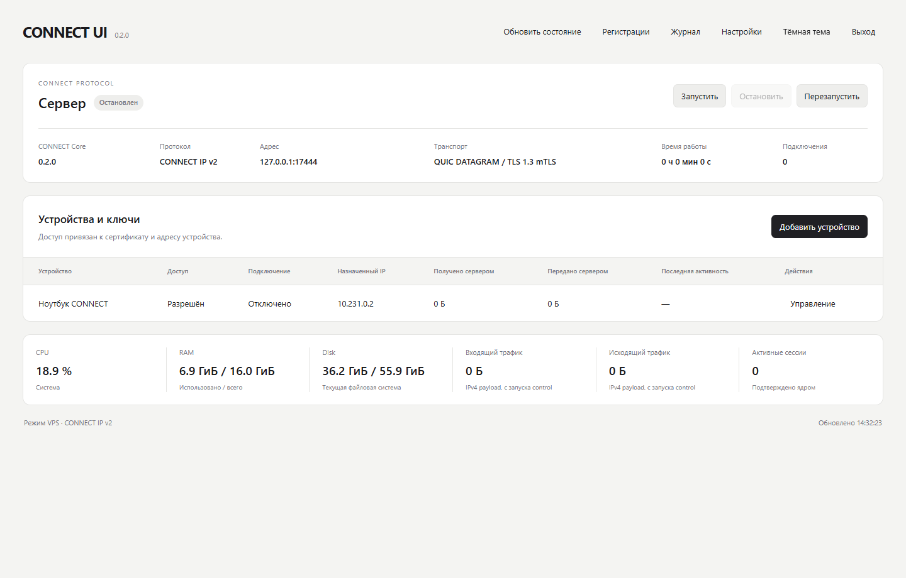
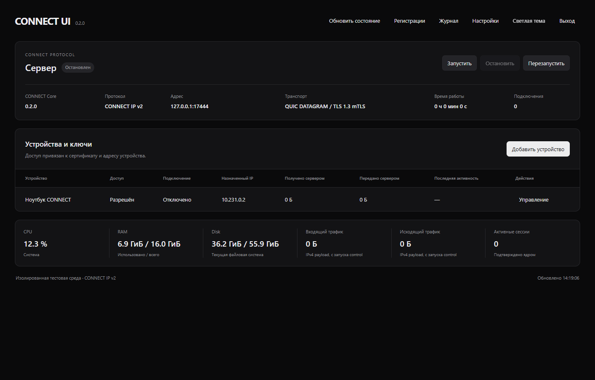

# CONNECT UI 0.2.0

Минималистичная локальная панель настоящего CONNECT IP v2 сервера: устройства,
доступы, текущие метрики и light/dark темы на одном экране. В существующем репозитории
находятся отдельные `connect-core`, `connect-control` и `connect-ui` компоненты.
Wire, ALPN, QUIC DATAGRAM и TLS 1.3 mTLS CONNECT IP v2 не изменены.

**Для обычной установки на VPS, обновления, отката и доступа по `connect://` см.
[VPS-INSTALL.md](VPS-INSTALL.md).** Это отдельный явно выбранный `managed-vps` режим,
а не скрытое отключение ограничений лаборатории. Панель и admin API остаются на
localhost; отдельный ограниченный HTTPS endpoint обслуживает только регистрации.

## Локальный лабораторный запуск

Go 1.27.0; Node не требуется для самой панели. HTML/CSS/JS встроены в бинарник.

```text
go build -o bin/ ./cmd/connect-core ./cmd/connect-control ./cmd/connect-ui
bin/connect-core init-lab panel-lab
bin/connect-control init control panel-lab/ip-server.json
bin/connect-ui init ui http://127.0.0.1:17891 control/control-token
bin/connect-control serve control/control.json
bin/connect-ui serve ui/ui.json
```

Последние две команды запускаются в разных терминалах. Windows использует `.exe`.
Первоначальный пароль (12+ байт) читается из stdin, не из аргументов процесса;
используйте приватный терминал. Открыть именно `http://127.0.0.1:17890`, пользователь
`admin`. Числовой Host проверяется; `localhost` не подменяет установленный адрес.
В лабораторном режиме data server первоначально остановлен. Создание панели не
меняет маршруты, firewall или существующие службы.

Реальный lab TUN на Linux требует отдельного disposable namespace. Для полного
теста в одноразовой VM/CI, **не на действующем VPS**:

```sh
sudo env CONNECT_LAB_MANAGED=1 bash scripts/ip-lab-linux.sh
```

Стенд сам создаёт и удаляет свои namespaces/маршруты. Windows TUN сохраняет прежний
явный VM opt-in. Локальный GUI smoke не создаёт TUN вообще.

## Управление и доступы

`connect-control` владеет настоящим сервером в своём процессе: работает после
открытия UDP/TUN, ошибка открытия — error, отсутствие control/API mismatch — unknown
с очищенными показателями в UI. Панель не управляет чужим systemd процессом или
старым отдельно запущенным `ip-server`.

Rename, disable, permanent revoke и delete используют реальный device pin. Отказ
сначала сохраняется на диск, затем закрывает активную QUIC-сессию и не допускает
новые handshakes/сессии/пакеты. Уже допущенная запись одного пакета в ОС может
закончиться; stalled write не задерживает отзыв. Отказ сохраняется при перезапуске
контроллера. Delete оставляет скрытый tombstone; тот же сертификат нельзя добавить
повторно. Адрес освобождается для нового сертификата. Максимум 32 одновременно
разрешённых привязки, 256 записей истории сертификатов.

Ошибка записи возвращается как ошибка, а не успех: отказ в памяти применяется,
но его durability после такой неуспешной операции не обещается. На Unix используются
fsync файла/каталога и atomic rename; на Windows синхронизируется файл. Старую
резервную копию state нельзя восстанавливать поверх новых отзывов. Update/rollback
бинарников не откатывает state. Злонамеренная замена диска и распределённые CRL
не реализованы.

Управляемый CA и HTTPS регистрации включают выпуск настоящих `connect://`/QR
приглашений. Клиентский импорт и подтверждение описаны в [VPS-INSTALL.md](VPS-INSTALL.md).
Из старого `init-lab` нельзя выпустить дополнительные сертификаты: его CA signing
key намеренно уничтожен. При отсутствии managed issuer кнопка добавления оставляет
проверку внешнего CA сертификата + свежего CSR challenge. Случайный загруженный
сертификат не заменяет идентификацию устройства и proof of key possession.

Экспорт каждой разрешённой записи — совместимый `ipvpn.Config` v2. `ca.pem`,
`device.pem` и `device-key.pem` — локальные клиентские пути; secret key сервер не
читает и не экспортирует. `server_name` извлекается из настоящего SAN. Для начальных
lab устройств нужен оригинальный leaf; для новых записей публичный leaf и CA можно
скачать из UI. Отозванный доступ не экспортируется как действующий.

## Защита панели

- Scrypt N=32768/r=8/p=1; случайные 256-bit salt, session и CSRF token.
- Один administrator; все administrative маршруты требуют session. Сессии
  живут 8 часов, максимум 32; logout и перезапуск UI их аннулируют.
- Cookie HttpOnly/SameSite=Strict; Secure при TLS. HTTP допускается только на
  numeric loopback. Login/мутации требуют точные Origin и специальный header;
  мутации после входа также требуют CSRF token.
- Пять login попыток в минуту; X-Forwarded заголовки не доверяются. Host проверяется
  против DNS rebinding. Core API требует приватный bearer, не доступный браузеру.
- Фиксированный список proxy routes, ограниченные headers/body/timeouts/registries.
  CSP, text-only rendering пользовательских имён; пароли, private keys и invitation
  bearer не попадают в журналы. QR генерируется сервером и показывает public TLS
  certificate плюс одноразовый token, а не private key.
- Unix файлы 0600/каталоги 0700; VPS installer отдельно разделяет пользователей
  панели/ядра и права к CA. Windows требует приватного каталога с корректным ACL:
  Unix mode-биты не устанавливают Windows ACL.

Смена пароля: `connect-ui password ui.json`, затем перезапуск панели. В installer
режиме остановить только `connect-ui.service`, изменить `/etc/connect-core/ui.json`
этой командой и снова запустить службу. Файл сохраняет private credentials.
Публичная публикация admin UI, автоматическая ACME/DNS настройка и доверие
произвольному reverse proxy в этой версии не включаются.

## Метрики и совместимость

| Формат/возможность | Поддержка |
| --- | --- |
| Bundle | 0.2.0; updater принимает совместимое семейство 0.2.x |
| Administrative API | `/v1`, api_version=1; неизвестная версия отвергается |
| Persistent state | version=1; bounded registries, unknown fields отвергаются |
| Data wire | CONNECT IP v2 без изменений; TCP v1 сохранён отдельно |
| Environment | isolated-lab или явно подготовленный managed-vps |
| connect URI | `connect://enroll`, v=1; реализованный Core CLI importer |
| QR | стандартный QR поддерживаемой ссылки, без private keys |
| Windows native/mobile handler | отсутствует, не подменяется ссылкой на несуществующий клиент |
| Update | reviewed pinned-source VPS command + health check + binary rollback |
| Нет | browser auto-update, уровни логов, подробная история, IPv6/full-device Windows VPN |

Host CPU/RAM и disk текущей ФС поступают из Windows/Linux API. Первый CPU sample
недоступен до второго замера; отсутствие метрики показывается как недоступность.
Traffic — успешно разрешённые IPv4 payload bytes с позиции сервера: received от
устройства, sent устройству. Это не полный объём QUIC/UDP/TLS на интерфейсе.
Счётчики/последняя активность живут в памяти control процесса и сбрасываются при
его перезапуске; access/revocation на диске остаются. Журнал — 100 событий управления.

```text
go test -count=1 ./...
go vet ./...
go test -race -count=1 ./...
node scripts/ui-browser-smoke.cjs
```

Браузерный тест требует собранных бинарников, Playwright 1.64.0 и Chromium.
Он использует отдельные реальные Core/UI/client процессы, CSR, CA, API и метрики;
data server в нём остановлен, без mock responses и без host networking.
Настоящий Linux TUN/forwarding/NAT/systemd проверяется в отдельном CI gate.
[Отчёт о проверках](CONNECT-UI-VALIDATION.md).




The manual configuration above retains its explicit local mode. The 0.2.1 VPS
installer instead configures public IP HTTPS with generated credentials,
automatic certificate renewal and external availability checks. See
[VPS-INSTALL.md](VPS-INSTALL.md) for the current one-command installation.
