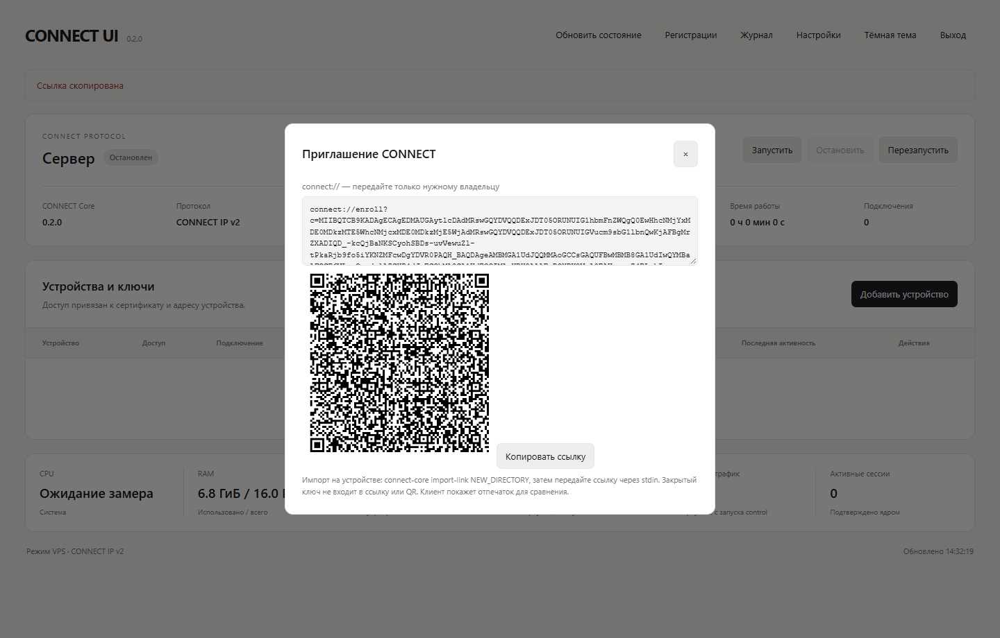
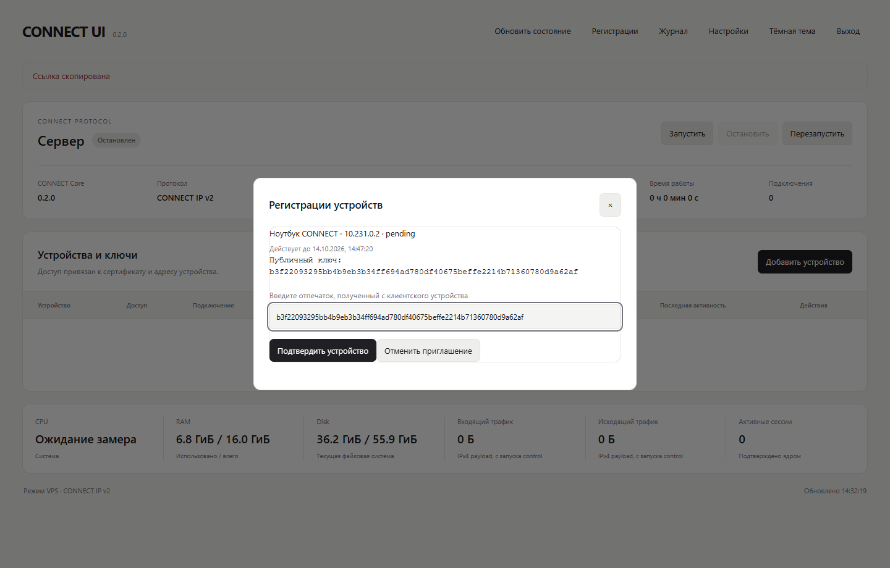

# CONNECT UI 0.2.0: VPS installation, updates and connect://

Установка создаёт отдельный CONNECT IP v2 сервер и панель рядом с существующими
VPN. Она не использует Xray/Sudoku/3x-ui, не занимает 443 и не перезапускает чужие
службы. Перед изменениями установщик показывает свой план и просит подтверждение.
Панель и административный API остаются на localhost. Наружу выставляются только
выбранный UDP-порт протокола и отдельный HTTPS-порт регистрации устройств.

## Одна команда

Linux amd64/arm64 с systemd, Python с поддержкой `tarfile` data filter, curl,
iproute2, iptables и доступным `/dev/net/tun`. Ubuntu 24.04 — проверяемая CI-среда.
Программа проверяет зависимости; при отсутствии системных пакетов останавливается
с их списком и не выполняет автоматический apt upgrade. Если Go отсутствует, Go
1.27.0 скачивается в временный каталог с проверкой официального SHA-256, без
установки в системный PATH. Код и зависимости собираются из закреплённого коммита.

Скопируйте команду целиком. Заменять адрес, версию или другие значения не нужно:

```sh
curl --proto '=https' --tlsv1.2 -fsSL https://raw.githubusercontent.com/sanderstripa/connect-core/integration/windows-ui-vm/scripts/install-vps.sh | sudo bash
```

Это одна команда, но изменения не бесконтрольные: после проверок нужно ответить
`yes` на конкретный план и ввести пароль панели дважды через скрытый терминальный
ввод. Пароль не находится в аргументах процесса, ссылках, журнале или выводе.
Текущая ветка — `integration/windows-ui-vm`, [интеграционный PR #5](https://github.com/sanderstripa/connect-core/pull/5).
Команда использует канал этой ветки, пока PR не слит. Установщик один раз получает
полный SHA канала через GitHub API и собирает исходники именно этого коммита;
SHA сохраняется в журнале установки. Явный `--revision` остаётся доступен.
Публичный IPv4 выбирается из адресов исходящего интерфейса VPS. По умолчанию
подбираются свободные порты начиная с 17444/17890/17891/17900 и отдельная /24,
не пересекающаяся с существующими маршрутами. Занятые порты пропускаются;
если порт задан явно, конфликт приводит к отказу, а не замене чужой службы.

Не запускайте команду на действующем VPS без согласования. Разработка и проверки
этой версии выполнялись на локальных фикстурах и одноразовом CI-сервере.

Дополнительные параметры:

```text
--panel-port 17890        локальная веб-панель
--control-port 17891      локальный защищённый API
--enrollment-port 17900   HTTPS регистрации, доступен на VPS_IP
--pool 10.231.0.0/24      отдельная частная сеть устройств
--uplink eth0            явный исходящий интерфейс, иначе из действующего маршрута
--password-file PATH     только файл 0400/0600, для автоматизации
--yes                    принять показанный план без диалога, явный opt-in
```

Все порты должны быть различными, свободными и от 1024. Установщик проверяет TCP/
UDP и IPv6 listeners консервативно: занятый номер порта не отбирается у другой
службы. Для облачного NAT, где публичный IP не назначен локальному интерфейсу,
автоматическая установка отказывает; требуется отдельная проверенная схема bind/
advertised endpoint. Контейнеры без systemd/TUN и rootless-хостинг не поддерживаются.

## Что создаётся и как сохраняются соседние VPN

- `connectcore` и `connectui`: разные системные пользователи без shell. Общая
  группа `connectadmin` даёт панели доступ только к control token, не к ключу CA.
- `connect-core-network.service`: создаёт один собственный persistent TUN,
  выделенную сеть устройств и точечные правила forwarding/NAT.
- `connect-core.service`: запускает реальное ядро и интерфейс регистрации,
  автоматически поднимает сервер только после открытия настоящего TUN/listener.
- `connect-ui.service`: непривилегированная панель на localhost.
- `/opt/connect-core/releases/`: неизменяемые сборки, атомарный symlink `current`.
- `/var/lib/connect-core/control/`: состояние, CA/серверные ключи и регистрации;
  доступно пользователю ядра, не панели.
- `/etc/connect-core/`: локальная авторизация панели и отдельный control token.
- `/var/lib/connect-core-installer/`: закрытый root-журнал владения и сетевого
  отката. Изменения чужих файлов никогда не восстанавливаются из чужой копии.

Если эти имена пользователей, службы, каталоги или `cc-vps0` уже существуют и не
принадлежат данной установке, программа отказывается их захватывать. Пересечение
выделенной /24 с действующими маршрутами также приводит к отказу.

В `iptables` добавляются только свои цепочки и точно ограниченные переходы с
уникальной меткой установки. Разрешаются выбранные входящие порты CONNECT, исходящий
трафик из его TUN и ответы established/related обратно; masquerade ограничен
выделенной сетью и выбранным uplink. Чужие цепочки и правила не очищаются, не
переписываются и не меняют порядок относительно друг друга.

Глобальный `net.ipv4.ip_forward` не изменяется: переключение этого параметра может
сбросить чужие IPv4 sysctl. Forwarding включается отдельно на новом TUN и выбранном
uplink. Если uplink уже forwarding-enabled, его настройка остаётся неизменной.
Прежнее значение записывается; при откате оно возвращается только если чужая сеть/
firewall с момента установки не изменились. Иначе разделяемый флаг сохраняется и
выдаётся сообщение для ручного согласования — без отключения нового соседнего VPN.

При обнаружении посторонних правил внутри собственной цепочки, замены интерфейса
с тем же именем, изменения unit-файла или UID установщик не удаляет чужой объект
силой, а останавливает откат с конкретной ошибкой. При обычной ошибке установки
свои службы, правила, TUN, пользователи и каталоги удаляются. Журнал нужен и для
восстановления после прерывания; потерю питания ровно между syscall и записью
метки нельзя считать автоматически проверенным сценарием.

В `managed-vps` разрешён публичный числовой IPv4 endpoint и Интернет IPv4. Политика
по умолчанию `/0` не открывает частные адреса, loopback, link-local/metadata,
multicast, CGNAT и нулевой блок. Адрес каждого пакета по-прежнему связан с клиентским
сертификатом. У сервера нет неизвестных ключей или фиктивного начального клиента:
пустой реестр означает отказ всем клиентам до одобрения.

Внешний firewall провайдера и дополнительные независимые firewall base chains
могут по-прежнему блокировать выбранные порты. Установщик их не переписывает.
Отсутствие публичной доступности не подменяется зелёной проверкой соединения
с удалённого устройства: локальный health-check проверяет процесс и TUN.

## Первый вход и устройство

Административная панель не публикуется автоматически. Например, с рабочего
компьютера:

```sh
ssh -L 17890:127.0.0.1:17890 user@VPS_IP
```

Открыть `http://127.0.0.1:17890`, войти как `admin` с введённым паролем.
Нажать «Добавить устройство», указать название и предложенный свободный IP.
Панель выдаст настоящую `connect://enroll?...` ссылку, кнопку копирования и QR.

На устройстве нужен **CONNECT Core 0.2.0 с новым CLI импортом**:

```sh
connect-core import-link NEW_PRIVATE_DIRECTORY
```

Передайте ссылку через stdin; завершите stdin (`Ctrl+D` на Unix, `Ctrl+Z` + Enter
в обычном Windows терминале). Ссылка не передаётся как аргумент процесса и не
печатается в журнал. Импорт создаёт Ed25519 key и подписанный CSR локально,
отправляет только CSR через защищённый HTTPS и выводит отпечаток публичного ключа.
Не передавайте `device-key.pem` серверу или другому устройству.

В панели открыть «Регистрации», независимо получить отпечаток с экрана устройства,
сравнить его с запросом и ввести для подтверждения. Само название устройства и
наличие приглашения не доказывают владельца. После подтверждения ядро выпускает
ограниченный ClientAuth сертификат, сохраняет привязку и разрешает подключение.
Клиент получает `ca.pem`, `device.pem`, `connect-ip-client.json`; закрытый ключ
остаётся в том же клиентском каталоге. CLI защищает этот каталог Unix 0700 или
Windows DACL только для текущего пользователя и SYSTEM. Для запуска обычного IP клиента его рабочий
каталог должен быть этим каталогом (экспорт содержит локальные относительные пути).

В ссылке есть только версия формата, HTTPS origin, одноразовый bearer token и
публичный TLS certificate для проверяемого trust anchor. Секретных ключей нет.
TLS 1.3 использует обычную проверку сертификата и имени, без `InsecureSkipVerify`.
Token хранится на сервере только как SHA-256 и не попадает в URL HTTP-запросов;
ссылка/QR показываются оператору один раз. Передавайте их конфиденциально:
приглашение всё равно является временным секретом регистрации.

Приглашение действует 15 минут. Первый корректный CSR привязывает его к одному
ключу; другой ключ или отменённое/истёкшее приглашение отвергается. Повтор запросов
**с тем же CSR** допускается для восстановления прерванного импорта, но не создаёт
ещё одно устройство. Одобренный результат можно получить в течение часа. Состояние
приглашения и device pin сохраняется на диск; two-phase issuance восстанавливает
сбой между записью сертификата и окончательным подтверждением. Перезапуск импорта
с тем же каталогом сохраняет тот же ключ/CSR. Просроченные записи автоматически
очищаются при заполнении bounded registry.

QR — стандартный QR с этой поддерживаемой CLI ссылкой. Автоматический Windows URL
handler, импорт в старый native lab client из PR #2, мобильное приложение и
автоматическая настройка всех клиентских маршрутов/DNS в этой версии отсутствуют.
Сканер может скопировать ссылку для `import-link`; нельзя обещать, что её откроет
произвольный существующий VPN-клиент. Протокол и wire остаются CONNECT IP v2.
Серверный VPS-режим не отменяет прежние ограничения lab-клиента на Windows.

## Обновление и откат

```sh
curl --proto '=https' --tlsv1.2 -fsSL https://raw.githubusercontent.com/sanderstripa/connect-core/integration/windows-ui-vm/scripts/install-vps.sh | sudo bash -s -- update
sudo python3 /opt/connect-core/current/scripts/connect-install.py rollback
sudo python3 /opt/connect-core/current/scripts/connect-install.py status
```

Новая сборка создаётся отдельно. Read-only `connect-control check` проверяет
совместимость текущих CA/TLS и state/API schemas до остановки процесса. Затем
останавливаются только Core/UI CONNECT, symlink меняется атомарно, службы вновь
запускаются и проверяется реальный running state. Собственный сетевой сервис остаётся
работать: update не трогает соседние службы и не пересоздаёт их сеть.

Если health-check не прошёл, возвращаются прежние бинарники и службы. State/CA,
пароль и приглашения не заменяются старой резервной копией: отзыв сертификата,
выполненный до update, не должен исчезнуть при rollback. Явный `rollback` использует
сохранённую предыдущую сборку по тому же правилу. Проверяется текущий bundle/schema
0.2.x / API v1 / state v1; миграции неизвестных форматов и незнакомые major версии
не применяются автоматически.

Удаление **всей собственной установки, включая ключи и устройства**, с подтверждением:

```sh
sudo python3 /opt/connect-core/current/scripts/connect-install.py uninstall
```

Это удаление отличается от rollback версии. При повреждённом ownership journal
автоматическое удаление чужих или неподтверждённых ресурсов запрещено.

Серверный CA рассчитан на 5 лет, server/TLS сертификаты на год, клиентский сертификат
на 30 дней. Не заявляется автоматическая ротация: перед истечением требуется
контролируемое продление/новое приглашение. Старый device pin после отзыва остаётся
tombstone, но освобождает адрес для нового сертификата; история ограничена 256 pins.
Удалённая HTTPS публикация самой административной панели по-прежнему отдельная
операция. Полный IPv6 и full-device Windows VPN/kill-switch не реализованы.

## Проверки

`vps-installer` CI на disposable systemd VM проверяет настоящие службы, отказ на
занятом порту, QR decode обратно в URI, живой клиентский импорт и approval, реальный
QUIC → TUN → scoped NAT → отдельный UDP service namespace, сбой обновления и
возврат прежней сборки, успешное update/rollback, сохранность revocation и соседней
HTTP-службы/iptables цепочки, точное удаление своих правил и маршрутов. Это не
тестирование на действующем VPS и не обещание поддержки любых комбинаций firewall.

Браузерный тест дополнительно проверяет копирование URI, настоящий QR, импорт
отдельным клиентским процессом, подтверждение отпечатка и обе темы без mock API.
Скриншоты приглашения из теста больше не дают доступ: fixture удаляется и её
сертификат отзывается. [Отчёт](CONNECT-UI-VALIDATION.md).



